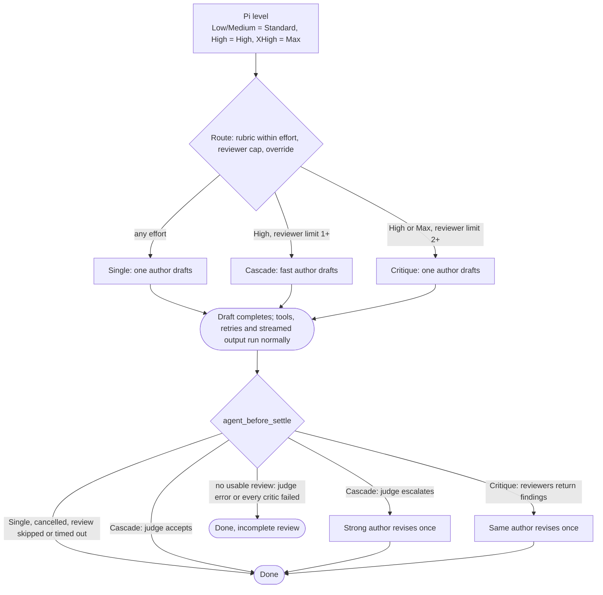

# Pi Fusion

> One selectable virtual model for [Pi](https://pi.dev) with task-aware Standard, High, and Max effort — inspired by, but not an exact implementation of, GitHub Copilot's orchestration.

[](https://github.com/pi-contrib/pi-fusion/actions/workflows/ci.yml)
[](https://github.com/pi-contrib/pi-fusion/releases/latest)
[](LICENSE)

## How it works

Select `fusion-auto` (`Fusion (auto)`) once, then use Pi's thinking-level selector. Pi's visible labels remain **Low / Medium / High / XHigh**; Fusion maps **Low and Medium → Fusion Standard**, **High → Fusion High**, and **XHigh → Fusion Max**. Pi 1.6.1 does not support custom virtual-model thinking-level labels. Fusion Fast is not user-selectable. Low and Medium share the Standard orchestration policy but retain their respective physical-model reasoning budgets.

The diagram is an orientation map of one task's lifecycle; the prose below is normative and covers the precedence rules (overrides, reviewer caps, cost limits, fallbacks) that do not fit in a chart.



The router applies the same task-aware rubric within each effort's allowed choices. **Standard** always runs Single, choosing fast or strong once without judges or critics. **High** can choose Single, fast-first Cascade, or Critique; Single and Critique may start fast or strong. **Max** always starts strong and chooses Single for straightforward tasks or parallel Critique when risk or complexity warrants it; Cascade is excluded. The chosen physical author works in Pi's ordinary streaming agent loop, including tools and retries. The initial draft may be visible before review.

- **Single**: one author completes the task without review.
- **Cascade**: an efficient author drafts; after its tool work finishes, a judge accepts or escalates. Acceptance ends immediately; escalation sends specific findings and evidence to the configured stronger author for one revision.
- **Critique**: one author drafts; configured critics evaluate the same draft independently in parallel. Their separate findings, including disagreements, go back to the **original** author for one revision. Critics have no tools or write access.

| Workflow | Initial author | Reviewers | After review | Available at |
| --- | --- | --- | --- | --- |
| **Single** | fast or strong | none | no revision | every effort |
| **Cascade** | fast (fixed) | one judge | strong author, one revision | High, reviewer limit ≥ 1 |
| **Critique** | fast or strong | one to N critics in parallel | same author, one revision | High and Max, reviewer limit ≥ 2 |

Reviewers never get tools or write access, and Max pins every author to strong. "Reviewer limit" is `min(critics.length, budget.maxReviewerCalls)`, so Critique needs at least two configured critics; a cap of `0` leaves only Single.

Reviews start at Pi's `agent_before_settle` boundary, after automatic recovery and queued work. A task has at most one review round and one revision. The active author alone can edit. Continuations and retries preserve the current author; direct calls route to the default physical author. State follows session branches. A compact 1-line Fusion bar sits above the input editor while idle (keeping the bottom footer single-line), and hides automatically while streaming so Pi's working border is the single live status line (`Choosing workflow`, `Drafting with …`, `Reviewing draft with …`, `Revising with …`); the draft and review/revision can appear as separate streamed responses. When a review requests a revision, a compact expandable `Fusion review` card (`Ctrl+O` to expand/collapse) shows the findings before the revised answer. Unstaged and staged Git diffs/status and the recorded tool/check results accompany the draft. Untracked contents require an explicit opt-in. Checks are not run automatically by Fusion.

To override the **next human task only**, run `/fusion` (opens an interactive picker in TUI), or `/fusion single`, `/fusion cascade`, or `/fusion critique` while `fusion-auto` is selected and idle, then send the task normally (including images, if any). Run `/fusion status` at any time to inspect the active config path, role models, availability, and budgets. For example, select Pi High, run `/fusion critique`, then ask “Fix the parser and add regression tests.” The bar above the input shows `◆ Next task: Critique · High` until that task begins. `/fusion auto` clears a queued choice; the following task after an override routes adaptively again. The command does not alter task text. Overrides persist in the active session branch across forks/reload: a fork before the task inherits the pending choice; a fork after the task preserves its chosen route. Direct calls do not consume an override.

Overrides **do not bypass** Pi effort or review budgets: Standard permits only Single, Max cannot Cascade and always starts strong, High Cascade always starts fast, and a reviewer cap can disallow review. If the effort changes after queuing to an incompatible level, routing explicitly fails rather than silently changing workflows; change the level back or clear/requeue. A soft task-cost limit may still skip the requested review, and the status says why. For forced Single or High Critique, the router only picks the initial author tier; fixed-tier workflows do not call the router. If routing times out or returns invalid output, forced workflows retain their workflow with the configured default author (Max uses strong); ordinary adaptive routing shows a status and runs Single with the default author at Standard/High, or strong at Max. If the judge fails, the draft completes with a visible incomplete-review status; if some critics fail, their failures accompany the successful findings for revision. If all critics fail, the draft completes with an incomplete-review status. Escape/cancellation skips further review or revision and propagates to nested calls.

## Choosing an effort

The router picks the workflow and the effort sets which choices are allowed, so pick the level that matches how much you would otherwise verify by hand:

| Effort | Typical workflow | Use when | Relative cost |
| --- | --- | --- | --- |
| **Low / Medium** (Standard) | Single | The change is clear and self-contained, and you want one author with no review latency | lowest |
| **High** (High) | Cascade, or Critique with a reviewer limit of 2+ | The change is worth a second look, and defects would surface in the diff, status, or recorded tool output | draft plus review, plus one revision if escalated |
| **XHigh** (Max) | strong Single, or parallel Critique | The spec is ambiguous or the change is high-risk or cross-cutting, so independent disagreement is worth paying for | highest; every author is strong |

These are heuristics, not routing rules: budgets, overrides, and fallbacks still decide what runs, and the status line reports the actual workflow. Prefer a direct physical model for one-line edits, exploratory back-and-forth, or anything needing more than the single review round and revision Fusion provides.

## Requirements

- Pi 1.6.0 or newer (developed against Pi 1.6.1)
- Credentials and access for each configured physical model; decision-model access for a classifier router

## Installation

Install the latest code from GitHub without a registry login:

```sh
pi install git:github.com/pi-contrib/pi-fusion
```

Or, after configuring npm authentication for `npm.pkg.github.com` and the `@pi-contrib` scope, install the latest release from GitHub Packages:

```sh
pi install npm:@pi-contrib/pi-fusion
```

For a reproducible install, append a release tag (GitHub) or version (npm). Restart Pi or run `/reload`.

## Configuration

Copy [examples/fusion.json](examples/fusion.json) to `~/.config/pi/fusion.json` (or `$XDG_CONFIG_HOME/pi/fusion.json` when `XDG_CONFIG_HOME` is an absolute path) and change the provider/model IDs to models in your Pi catalog with credentials. A project-local `.pi/fusion.json` overrides the user config; `PI_FUSION_CONFIG` overrides both (absolute paths recommended, relative paths resolve from the working directory). Config is cached by resolved path for the Pi session; restart or `/reload` after changing a file. Projects without an override use the global config. The example needs TypeSafe and OpenAI Codex access. The `router`, `fast`, `strong`, `judge`, and each `critics` entry are independent physical models; they may share the same provider/model. `defaultAuthor` is `fast` or `strong`; `timeoutMs` bounds each internal call. No role may point to `fusion-auto`.

For review of new files, add `"reviewEvidence": { "includeUntracked": true }`. By default only untracked paths appear in Git status; with opt-in, up to 10 non-ignored regular UTF-8 text files (16 KiB each, 32 KiB total) are included for the judge or critics. Symlinks, binaries, oversized/unreadable files and obvious sensitive filenames such as `.env*`, credentials and private keys are excluded; skipped files are noted. This filtering **cannot guarantee secrets are absent**: enabling it sends eligible new-file content to configured remote review models. Staged and unstaged diffs and Git status are included regardless of this setting, but paths with sensitive names (`.env*`, credentials, keys, tokens) are excluded from them too. The first review per config shows a notice naming the reviewer models that receive your request, draft, tool output and diffs. Task text from image prompts is kept, with a marker noting that images are not shown to reviewers.

An optional `budget` object controls extra review work, without changing Pi's author reasoning level:

```json
"budget": { "maxReviewerCalls": 2, "maxTaskCostUsd": 1.00, "maxReviewMs": 15000 }
```

- `maxReviewerCalls` is a nonnegative integer: `0` restricts routing to Single, `1` permits High Cascade, and `2` or more permits parallel Critique (up to the configured number of critics). Max always starts strong. The cap is enforced in routing and at review.
- `maxTaskCostUsd` is a **soft review-start threshold**, not a spending cap: when reported router cost alone reaches it, Fusion routes Single; otherwise, if the observed cost of the current task's author messages plus reported router cost reaches it, Fusion keeps the draft and skips optional review. It cannot predict or stop the author's next tool/model call, nor account for unreported usage or all reviewer charges. No automatic downgrade of a selected author occurs. The status explains when review is skipped.
- `maxReviewMs` limits the whole judge/parallel-critic round (in addition to `timeoutMs` per call). On timeout Fusion keeps the draft without revision; it does not time-limit the author or revision. Cancellation still propagates. All three fields are optional; leaving out `budget` preserves existing behavior.

The router first uses Pi's classifier registry when the selected decision model is present (for example `typesafe/jev-latest`, supplied by a provider extension). A configured, available Pi chat model otherwise returns validated JSON using the same rubric (for example a Muse Ember chat model). If routing fails, Fusion shows a warning with the reason and runs Single. The editable runtime prompts are in [src/prompts.ts](src/prompts.ts); workflow limits live in TypeScript. Routing also selects a short categorical task signal in the **same call** (no extra model call). Status shows that signal when consistent with the chosen workflow; otherwise it shows a policy/fallback/override reason. Signals are model-selected categories, not verified access to a model's private reasoning, and never bypass effort or budget constraints.

Select the model with `/model` → `fusion-auto` (`Fusion (auto)`), or run `pi --model fusion-auto`. For example, ask: “Add a regression test for the parser bug and fix it.” At **Fusion Standard** (Pi Low or Medium), one selected author inspects and edits the parser and runs tests without a judge. At **Fusion High** (Pi High), the router may instead choose Cascade: the fast author drafts and a judge sees the request, draft, test output, and diff; if the regression test is missing, the strong author gets that finding for one final revision. At **Fusion Max** (Pi XHigh), an ambiguous or high-risk change may get parallel Critique and one revision by the same strong author; a straightforward change may use strong Single.

## Development

Use Node.js 22 locally or enter the Nix dev shell with `nix develop`:

```sh
npm ci --ignore-scripts
npm run check
npm run lint
npm test
npm pack --dry-run
nix flake check
pi -e ./src/index.ts --model fusion-auto
```

`nix flake check` runs the tests and package dry-run offline on the current system; CI additionally installs dependencies and runs TypeScript and Biome. Run `npm run format` to apply Biome formatting, import sorting, and safe lint fixes.

Release Please creates release PRs from conventional commits on `main`. Merging one updates the manifest and changelog, tags `vX.Y.Z`, creates a GitHub Release, and publishes the tagged npm package to GitHub Packages after CI passes. Configure Actions to create pull requests (workflow read/write permissions), allow `GITHUB_TOKEN` package publication in the organization, and grant the workflow `contents`, `issues`, `pull-requests`, and `packages` permissions as shown in [CI](.github/workflows/ci.yml). No separate npm token is needed for the reference GitHub Packages flow. No release is triggered merely by this checkout.

## License

MIT.
